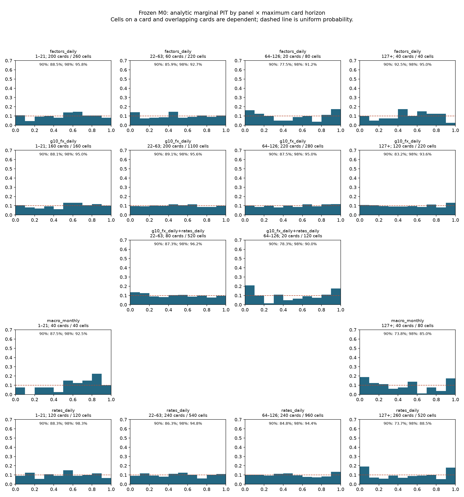

# Agenthon Track 2 — Phase 2 results

Measured October 14, 2026 · 2,000 draws · Lower scores are better

## Verdict

The frozen numeric_v1 improves the development CV and reserved-year means, and
passes all 104 admissibility checks. **The paired capped-card reduction target
is unmet.** It ties M0's total cap count and increases caps in 2019–2024.
The final mean improvement is small relative to year-to-year uncertainty, so
these results do not establish a robust improvement in the sealed final window.
No candidate was tuned after revealing reserved-year or practice results.

## Main results

| Evaluation | Cards | M0 mean | Numeric mean | M0 caps | Numeric caps | Numeric median |
|---|---:|---:|---:|---:|---:|---:|
| Primary year CV: 2009–2018 | 1073 | 1.033389 | 0.953077 | 1 | 1 | 0.703835 |
| Reserved: 2019–2024 | 554 | 1.480838 | 1.456363 | 15 | 17 | 0.808653 |
| All historical, descriptive | 2060 | 1.210785 | 1.154244 | 23 | 23 | 0.760472 |
| Practice proxies, report only | 88 | 2.551735* | 2.435614 | 11* | 9 | 1.376961 |

*Practice M0 is the original 500-draw measurement; all historical paired rows
recompute M0 at 2,000 draws. Original historical M0 was 1.214629 with 24 caps;
its 2,000-draw control is 1.210785 with 23. Comparing 23 numeric caps against
24 original M0 caps would confound model and Monte Carlo changes.

Reserved-year wins: **4 of 6**. The equal-year mean paired delta is **−0.034823**,
with year-cluster standard error **0.050554** (only six years). This uncertainty
includes zero improvement. The primary CV winner was selected using the same
development CV scores, so its CV result may be optimistic.
Reserved monthly macro also worsens from **1.6288 to 2.0143 (+23.7%)** on 26 cards.

## Validation protocol

Step 1 diagnosis was written to BUILD_LOG before Step 2; the protocol was
recorded before any candidate score. Development uses 2005–2018, with 2005–2008
warm-up labels and one primary test fold for each year 2009–2018 (1,073 cards).
Fixed rules estimate moments only from each card's pre-cutoff history. The only
outcome-fitted parameter is global width; each fold fits it on earlier years,
purging cards whose targets cross the test-year boundary. The final rule was
frozen before scoring 2019–2024 (554 cards), then practice proxies.

M0 outcomes across all years were inspected in the required diagnosis, so the
reserved period is a candidate holdout, not a completely untouched dataset.
Practice uses 85 inferred dates and 3 explicit monthly targets. Latest-vintage
macro unions, G10 substitutions for EM shapes, and business-day calendars remain
limitations. No sealed outcomes or organizer feedback were used.

## Ordered ablations

Each row is compared with the previous accepted best, identified in the detailed
JSON. Accept only a lower primary mean, no increase in caps, and no >10% loss in
a major family/panel/horizon/shape group. Major means at least 40 cards, or 20
for monthly macro. Every candidate and its full breakdowns are retained.

| Candidate | CV mean | Median | Caps | Change in mean | Decision |
|---|---:|---:|---:|---:|---|
| M0 control | 1.033389 | 0.738898 | 1 | +0.000000 | Control |
| Zero drift | 0.963807 | 0.707033 | 1 | -0.069582 | Reject: group regression |
| 25% drift | 0.959594 | 0.711342 | 1 | -0.073795 | Kept |
| EWMA volatility | 0.960115 | 0.714071 | 0 | +0.000521 | Reject: mean |
| Recent/history blend | 1.025695 | 0.823174 | 0 | +0.066100 | Reject: mean + groups |
| Empirical variance ratio | 0.964567 | 0.711804 | 1 | +0.004972 | Reject: mean |
| Student-t, df 5 | 0.999990 | 0.796998 | 0 | +0.040396 | Reject: mean |
| 5% volatility mixture | 0.973108 | 0.744962 | 0 | +0.013514 | Reject: mean |
| Rates mean reversion | 0.963709 | 0.719783 | 1 | +0.004115 | Reject: mean |
| Monthly trend/persistence | 0.953506 | 0.706513 | 1 | -0.006089 | Kept |
| Joint shrinkage/paths | 0.953077 | 0.703835 | 1 | -0.000428 | Kept |
| Fold-fitted width | 0.966927 | 0.725950 | 1 | +0.013850 | Reject: mean |

The kept rules are 25% trailing drift, monthly positive-index log trend over
12 changes with UNRATE persistence, and 20% correlation shrinkage using up to
1,260 aligned changes. Each draw shares multivariate shocks across assets;
later horizons add independent continuation. Volatility remains the original
300-observation estimate, tails remain Gaussian, and width remains 1.0.

Zero drift improved the aggregate but hurt monthly macro beyond the limit.
The EWMA and high-volatility alternatives reduced development caps but worsened
mean score. Longer-history variance made quiet-period distributions too broad.
Rate reversion and empirical variance ratios also failed the mean gate. The
joint-stage gain is only 0.000428 and should not be treated as independently
statistically established. All tuning menus were fixed in advance.

## Reserved-year breakdowns

| Group | Cards | M0 mean | Numeric mean | M0 caps | Numeric caps |
|---|---:|---:|---:|---:|---:|
| family: T2-F1 | 122 | 2.1836 | 2.0610 | 11 | 12 |
| family: T2-F2 | 144 | 1.2691 | 1.2368 | 2 | 1 |
| family: T2-F3 | 121 | 1.4725 | 1.4984 | 0 | 2 |
| family: T2-F4 | 167 | 1.1561 | 1.1736 | 2 | 2 |
| panel: factors_daily | 77 | 1.1042 | 1.0850 | 1 | 1 |
| panel: g10_fx_daily | 183 | 1.1455 | 1.0864 | 2 | 2 |
| panel: g10_fx_daily+rates_daily | 20 | 1.6292 | 1.7232 | 0 | 1 |
| panel: macro_monthly | 26 | 1.6288 | 2.0143 | 2 | 2 |
| panel: rates_daily | 248 | 1.8177 | 1.7646 | 10 | 11 |
| horizon_bucket: 127+ | 122 | 2.1836 | 2.0610 | 11 | 12 |
| horizon_bucket: 1–21 | 137 | 1.0789 | 1.1258 | 1 | 1 |
| horizon_bucket: 22–63 | 158 | 1.3684 | 1.3111 | 0 | 1 |
| horizon_bucket: 64–126 | 137 | 1.3866 | 1.4161 | 3 | 3 |
| shape: joint | 236 | 1.7829 | 1.7469 | 10 | 13 |
| shape: single | 318 | 1.2567 | 1.2407 | 5 | 4 |
| year: 2019 | 91 | 1.2568 | 1.3561 | 0 | 0 |
| year: 2020 | 95 | 1.5548 | 1.4570 | 2 | 1 |
| year: 2021 | 110 | 2.1972 | 2.0428 | 13 | 12 |
| year: 2022 | 119 | 1.5860 | 1.7295 | 0 | 4 |
| year: 2023 | 97 | 0.8454 | 0.7542 | 0 | 0 |
| year: 2024 | 42 | 1.0923 | 0.9839 | 0 | 0 |

## M0 diagnosis before tuning

Nominal 90% and 98% intervals cover **85.13% and 94.09%** of 5,260 cells.
Mean z is +0.0193, median +0.0030, RMS 1.3825. Opposing regime errors cancel in
the signed average. Long rates and monthly macro are the weakest calibration
areas; uniformly doubling width worsens mean score from 1.2146 to 1.5013.

Hindsight center/width experiments allocate 0.7103 of score reduction to center
and 0.2572 to width, leaving 0.2471 at the chosen oracle widths. These are
postmortem oracle diagnostics, not deployable predictions or irreducible risk.
Zero drift alone scores 1.1825 overall but hurts monthly macro.

The original 24 capped cards comprise 15 provisional regime breaks, five
monthly/vintage issues, three volatility spikes, and one drift extrapolation.
No bug was demonstrated. Repeated UST_2Y cards in late 2021 are overlapping
examples of the same quiet-to-moving transition. "Monthly/vintage" flags the
known data limitation; it does not prove revisions caused the error.

Full capped-card inventory, all panel × horizon coverage, and methodology are
in [DIAGNOSIS.md](DIAGNOSIS.md). The CSV files retain all values and PIT bins.

## Operational checks

- 52 tests pass, including neutral-hook byte identity, seed determinism,
  future-data exclusion, independent continuation, monthly mapping, and both
  fallback levels. Existing macOS NumPy BLAS warnings remain finite-output
  warnings in baseline tests; numeric_v1 uses explicit NumPy contractions.
- 104/104 official admissibility passes at 2,000 draws, maximum host forecast
  time 0.066 seconds in the recorded sweep. Historical maximum is 0.094 seconds.
- Full official CLI scoring of 2,060 numeric forecasts agrees with the fast
  ablation adapter within 8.9e-16. Zero inference failures.
- linux/amd64 build and offline docker-smoke pass g0–g3 with read-only root,
  no network, and a small non-executable temporary filesystem.
- The image contains only runtime code and numerical dependencies. The build
  allowlist excludes evaluation data, vendor code, reports and realized values.
- No competition pack or submission upload command was run.

## Image publication

The package [agenthon-numeric-v1](https://github.com/hhwolf/agenthon/pkgs/container/agenthon-numeric-v1) is **Public**. GitHub Actions completed 52 tests, 104/104 admissibility gates (maximum Linux forecast time 0.174 seconds), an amd64 build, and the offline smoke test before publishing. [Successful workflow](https://github.com/hhwolf/agenthon/actions/runs/38650043739).

Immutable image:

`ghcr.io/hhwolf/agenthon-numeric-v1@sha256:25ffda44821a0493ba5ba69aeb570ec009a5e1081cd54d5e615fa3d51ac70a01`

The convenience tag is `numeric_v1`; the immutable commit tag is `b1f2225a5ef35a06c6f68e63c4f2c617cf49d300`. The starter-pack anonymous token/manifest check returned HTTP 200, as did all config/layer checks. A real Docker pull passed with an empty temporary credential configuration. The downloaded digest also passed all four official gates offline. The image runs as `runner`, declares no volumes, and contains no evaluation package, vendor tree, or parquet data. Evidence: anonymous-pull.json and published-image-smoke.json.

## Artifacts and reproduction

See [VALIDATION.md](VALIDATION.md), [ablations.json](ablations.json),
[ablation-breakdowns.csv](ablation-breakdowns.csv),
[frozen-selection.json](frozen-selection.json), and
[final-evaluation.json](final-evaluation.json). Per-card candidate CSV files
include every development/warm-up card; primary means filter 2009–2018.
The [numeric engine guide](../../docs/NUMERIC_V1.md) gives commands and the
optional text-signal contract. BUILD_LOG contains the chronological audit.

Status: the numeric engine and evaluation are implemented. The requested
accuracy gate remains open because capped-card count did not improve on the
paired historical comparison and increased in the reserved period.
